<!-- [COMP-01] IDENTITY HEADER -->

  

<!-- [COMP-02] SINGULARITY CORE TELEMETRY -->

 

<!-- [COMP-03] & [COMP-04] CROBAT SVG SPRITE ANIMATION + JSON SVG SIDE BY SIDE -->
<table width="100%">
  <tr>
    <td width="34.5%" align="center" valign="middle">
      
    </td>
    <td width="65.5%" align="center" valign="middle">
      
    </td>
  </tr>
</table>

 

<!-- [COMP-05] STACK MATRIX -->

 

<!-- [COMP-06] HORIZONTAL COMMIT PULSE WAVEFORM -->

 

<!-- [COMP-07] FOOTER SIGNATURE -->

