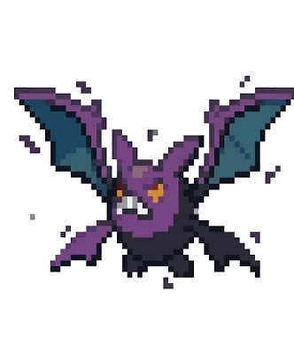

  

# Pixel Bat 3

Os 3 quadros originais animados em loop, sem redesenho:

- **CSS** (`index.html` + `style.css`): `assets/sprite.png` tem os 3 quadros lado a lado, e a `background-position` anda de quadro em quadro com `animation: steps(3)`.
- **SVG** (`assets/bat.svg`): a mesma sprite embutida no arquivo, que funciona dentro do README.

## Como ver

- README: abra este arquivo no VS Code e use `Ctrl+Shift+V`.
- CSS: abra o `index.html` no navegador (ou use a extensão Live Server).
